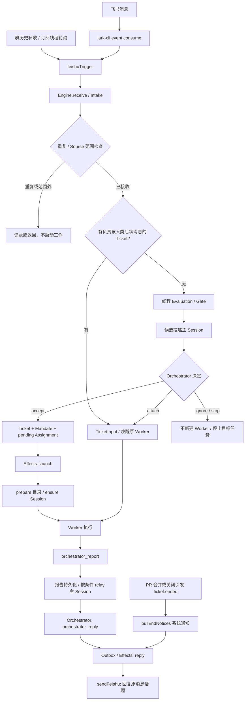

# 飞书请求如何转成 Worker 任务：dsh-superagent-prototype 源码追踪

## 0. 阅读范围与结论口径

本文研究公开上游 [deepseek-ai/dsh-superagent-prototype](<https://github.com/deepseek-ai/dsh-superagent-prototype>) 的固定提交 [`6337fc823ce20251c8de8085948165c81aaa701e`](<https://github.com/deepseek-ai/dsh-superagent-prototype/commit/6337fc823ce20251c8de8085948165c81aaa701e>)（提交时间：2026-10-31 12:05:39 UTC）。以下源码链接均锁定该版本，不代表今后的最新版，也不把某个实际部署的提示词或配置当作上游默认行为。

特别注意：上游 [README:3–7](<https://github.com/deepseek-ai/dsh-superagent-prototype/blob/6337fc823ce20251c8de8085948165c81aaa701e/README.md#L3-L7>) 明确声明它是**研究原型，不是 DeepSeek 官方产品**，公开版本也不完全等同内部实现或相关文章。因此，本文的“上游源码”指该公开仓库，不表示生产能力承诺。

- **【实现】**：能定位到该版本的代码分支、类型或调用；不等于本次已做端到端运行验证。
- **【提示词约束】**：代码把规则交给模型遵守，不能自动等同于确定性强制校验。
- **【推断】**：从实现推导出的设计意图、风险或使用解释，单独标注。
- 本次只读公开源码及相关文档、测试，不修改上游源码，不读取凭据或实际部署配置，不运行飞书收发链路。

**一句话结论：【实现】飞书消息不是直接启动一个 Worker。它先被 Source 转为 `Trigger`，经去重、接收范围检查和线程分流；需要新工作的消息再进入 `Evaluation`，由 Orchestrator 作决定。`accept` 创建 `Ticket + Mandate + Assignment` 并排入异步启动队列，Executor 准备目录并投递到每工单独立的 DSH Session。Worker 报告先回到系统，通常由 Orchestrator 决定回复，经 Outbox 回到原飞书消息；PR 合并/关闭引发的工单终态通知另有系统直发路径。已有工单线程的人类后续消息通常直接变成 Input，不重新接单。**

## 1. 总览：对象与两条入口分支



图中是逻辑调用链，不表示一个独立消息总线产品。关键对象见 [model.ts：`Trigger`、`Evaluation`、`Mandate`、`Assignment`、`TicketInput`](<https://github.com/deepseek-ai/dsh-superagent-prototype/blob/6337fc823ce20251c8de8085948165c81aaa701e/src/core/model.ts#L22-L255>)：

| 对象 | 在链路中的含义 |
| --- | --- |
| `Trigger` | Source 归一化的一次外部事件，保留发送者、原文、线程和回信地址；不天然授权执行。 |
| `Thread` | 评估批次和订阅关系的边界；同一线程最多一个在途 Evaluation。 |
| `Evaluation` | 待 Orchestrator 决定的一批 Trigger，记录授权强度、主要 Trigger、策略版本及超时。 |
| `Decision` / `Mandate` | 是否接受等决定；接受后持有不可变的授权来源、强度和范围。 |
| `Ticket` / `Assignment` | 工单与一次执行安排；重试可有新 Assignment，不必换工单或 Session。 |
| `TicketInput` | 后续消息、恢复通知、策略变化等输入，不必新建任务。 |

## 2. 消息接收：实时事件与补收共用归一化路径

### 2.1 实时入口

【实现】[feishu.ts：`apply`](<https://github.com/deepseek-ai/dsh-superagent-prototype/blob/6337fc823ce20251c8de8085948165c81aaa701e/src/sources/feishu.ts#L130-L139>) 注册 `feishuKind` 并启动 `runFeishu`。后者并行运行事件监听、历史补收和群名称刷新。

[feishu-loops.ts：`watch` / `consume`](<https://github.com/deepseek-ai/dsh-superagent-prototype/blob/6337fc823ce20251c8de8085948165c81aaa701e/src/sources/feishu-loops.ts#L18-L105>) 启动配置的 CLI：

```text
lark-cli event consume im.message.receive_v1 --as bot
```

进程逐行读取 stdout 的 JSON，用 Promise 链串行处理，交给 `feishuTrigger`，再调用 `ctx.receive`。它不在这里自行实现飞书 WebSocket 协议；CLI 的内部传输实现不在本仓库的证据范围内。监听等待 ready 标记，45 秒未就绪会终止；异常退出按 1 秒至 60 秒退避重启。关闭 Source 后检查并停止消费者。

### 2.2 断线补收与线程轮询

【实现】[feishu-loops.ts：`backfillLoop` / `backfillChat` / `pollThread`](<https://github.com/deepseek-ai/dsh-superagent-prototype/blob/6337fc823ce20251c8de8085948165c81aaa701e/src/sources/feishu-loops.ts#L128-L267>)：

- 补收配置群和已经见过且允许接收的私聊；每轮结束后等待 60 秒，不是严格每分钟固定完成。
- 首次没有历史游标时，只把当前时间设为起点，**不会自动把全部旧群历史转成工作**。
- 通过消息历史 API 分页扫描群和已跟踪话题，`historyEvent → feishuTrigger → receive`；成功后推进游标，并检查分页是否前进。
- 对订阅线程额外轮询，维护已见消息集合；首次把根消息、父消息标为已见，并忽略订阅建立前的旧回复，避免把历史上下文误作新请求。

这与模型主动读取上下文不同：[feishu-read.ts：`readFeishu` / `feishuRead`](<https://github.com/deepseek-ai/dsh-superagent-prototype/blob/6337fc823ce20251c8de8085948165c81aaa701e/src/sources/feishu-read.ts#L39-L96>) 只返回原消息、父消息、根消息和分页上下文供阅读，**不把这些读取结果自动送入 Intake**。

### 2.3 转为 Trigger

【实现】[feishu-trigger.ts：`feishuTrigger` / `feishuThreadId` / `feishuTriggerId`](<https://github.com/deepseek-ai/dsh-superagent-prototype/blob/6337fc823ce20251c8de8085948165c81aaa701e/src/sources/feishu-trigger.ts#L6-L50>) 做以下映射：

| 飞书信息 | 领域字段 / 处理 |
| --- | --- |
| `message_id` | `key('feishu', messageId)` 生成稳定 Trigger ID；实时、补收、轮询读到同一消息会得到同一 ID。 |
| `chat_id`、`root_id` | 线程 ID 为 `chatId:(rootId ?? messageId)`；完整领域键再加 `feishu:` 前缀。不是直接拿 `thread_id` 当领域键。 |
| 发送者、`sender_type` | `actor` 与 `human`；本机器人 bot ID 或 app ID 发出的消息直接忽略。 |
| 私聊或 mentions | `addressed: 'direct'` 或 `'mention'`，不是靠正文搜索 `@机器人名字`。 |
| 正文和时间 | 替换 mention 占位名、归一化时间；保留原文和可用的原消息链接。 |
| 回信地址 | `channel.address` 保留 `chatId + messageId`，私聊额外标 `direct`；与领域 Thread 的标识职责不同。 |

## 3. 准入：接收范围、订阅分流、Gate 是三件事

### 3.1 先持久化、去重和 Source 范围检查

【实现】[Runtime 构造与 `sourceDeps`](<https://github.com/deepseek-ai/dsh-superagent-prototype/blob/6337fc823ce20251c8de8085948165c81aaa701e/src/app/runtime.ts#L137-L165>) 将 Source 的 `receive` 接到 Passes，再进入 Engine。核心逻辑在 [intake.ts：`Intake.receive`](<https://github.com/deepseek-ai/dsh-superagent-prototype/blob/6337fc823ce20251c8de8085948165c81aaa701e/src/core/intake.ts#L19-L61>)：

1. 已存在同 ID Trigger 则返回 `duplicate`。
2. Source scope 不接收时，仍保存 Trigger 和 `filtered` disposition，再返回 `filtered`。
3. 接收时保存 Trigger、更新 Thread 的时间和关联关系，先向订阅工单分发 Input。
4. 如果没有 Worker 负责该人类后续消息，才排入 Evaluation；最后唤醒有关工单。

【实现】[feishu.ts：`feishuKind.scope`](<https://github.com/deepseek-ai/dsh-superagent-prototype/blob/6337fc823ce20251c8de8085948165c81aaa701e/src/sources/feishu.ts#L54-L65>) 决定私聊、配置群、其他群是否在范围内。配置群的 `listen: 'mentions'` **不是逐条丢弃所有未 @ 消息的 Intake 过滤器**：该群 `listened` 仍为 true，`observed` 仅在 `all` 时为 true；是否能发起新工作还要看后面的 Gate。范围外群不会因为有订阅就绕过 Source scope。

### 3.2 已有工单后续消息：不等于新授权

【实现】同一 `Intake.receive` 会向订阅工单 fan-out，包括机器人消息作为上下文。`followupOwners` 在 [model.ts:68–87](<https://github.com/deepseek-ai/dsh-superagent-prototype/blob/6337fc823ce20251c8de8085948165c81aaa701e/src/core/model.ts#L68-L87>) 判断谁负责一条人类后续消息：

- 人类在工单自身线程的后续消息，通常直接由该 Worker 判断是否属于原任务，主 Session 不再重复接单。
- 仅为上下文关注的线程不赋予该 Worker 跟进所有权，也不会唤醒已结束工单。
- 机器人和 CI 不能凭消息恢复已结束工单；人类后续消息可在原 Mandate 下触发恢复，人工明确停止的工单例外。
- Worker 可用 `orchestrator_trigger_handback` 交还超范围消息，等没有其他工单仍负责它后重新评估；见 [executor.ts：`executorTools`](<https://github.com/deepseek-ai/dsh-superagent-prototype/blob/6337fc823ce20251c8de8085948165c81aaa701e/src/app/tools/executor.ts#L41-L73>)。

因此，“后续消息已送到 Worker”不等于“发送者获准发起任意新工作”。【推断】这里把授权边界的语义判断部分留给 Worker，是避免每条回复都重新立项的机制，而不是所有后续内容都自动执行的保证。

### 3.3 新候选的 Gate

【实现】[policy.ts：`settingsPolicy` 的 `gate` / `machineGate` / `admitsInferred`](<https://github.com/deepseek-ai/dsh-superagent-prototype/blob/6337fc823ce20251c8de8085948165c81aaa701e/src/policy.ts#L170-L212>)：

- 允许名单内的人 @ 机器人或向机器人私聊，构成 `explicit` 候选；**explicit 表示有明确授权强度，不表示系统已经确认正文必然是待执行工作**。
- 其他人、未 @ 消息等走对应 Source 行的 admission table；未 @ 消息使用该表需 Source 在该范围 `observed=true`。
- 准入表可以给出 `explicit`、`inferred` 或忽略；不是简单的“名单外永远不能参与”。表中的 explicit 优先；其后还有 `participating(thread, tickets)` 的 followup Gate 分支：名单内为 explicit，名单外在模式非 off 时可为 inferred，未列名私聊例外。这与前述 Intake 的“已归 Worker 的后续消息直接分发”不是同一分支，也不能把准入表 ignore 当作在此后续分支必然拒绝。
- bot 候选有单独名单与分支，至多为 `inferred`，受接收范围、是否被 addressed/observed 和接受模式约束，不能成为明确请求或明确停止授权。
- `inferred` 真正自动接单还要求模式为 `auto`，且匹配的规则存在并启用。`observe` 不等于自动执行，`off` 也不能被当成“关闭所有 explicit 请求”。

## 4. 接单：模型决定语义，Engine 固化领域状态

【实现】[passes.ts：`Passes.receive` / `start` / `pumpOnce`](<https://github.com/deepseek-ai/dsh-superagent-prototype/blob/6337fc823ce20251c8de8085948165c81aaa701e/src/app/passes.ts#L28-L67>) 在 stored 消息到达后请求即时 pass，另每 2 秒触发一次周期 pass；它不是等 60 秒历史补收才开始接单。

[evals.ts：`Evals.start`](<https://github.com/deepseek-ai/dsh-superagent-prototype/blob/6337fc823ce20251c8de8085948165c81aaa701e/src/core/evals.ts#L70-L118>) 对同一线程的待评估批次逐条 gate，优先选 explicit、同强度选较晚消息作为 primary；全部不准入则直接 ignore，不交模型。有强候选时其他弱消息也可能作为批次上下文。一个批次可以有多条消息，所以不能把“一条消息 = 一个工单”当作恒等式。

[assessment.ts：`MasterAssessor.request` 与 assessment handler](<https://github.com/deepseek-ai/dsh-superagent-prototype/blob/6337fc823ce20251c8de8085948165c81aaa701e/src/app/assessment.ts#L94-L114>) 将 candidate 经 effect 投递到主 Session，随后才调用 `candidateDelivered` 开始计算评估超时；未投递的候选不会仅因主 Session 忙就被判超时。暂停时超时期限会顺延，见 [evals.ts：`delivered` / `expire`](<https://github.com/deepseek-ai/dsh-superagent-prototype/blob/6337fc823ce20251c8de8085948165c81aaa701e/src/core/evals.ts#L40-L68>)。

【实现】[main.ts：`route` / `routeTool`](<https://github.com/deepseek-ai/dsh-superagent-prototype/blob/6337fc823ce20251c8de8085948165c81aaa701e/src/app/tools/main.ts#L88-L151>) 提供 `orchestrator_route`：

| 决定 | 效果 |
| --- | --- |
| `accept` | 将明确请求交给 `Engine.decide`，给出标题、工作区短名和确认语；创建新工单。 |
| `attach` | 交给 `Engine.attach`，让已有工单订阅该消息的线程并接收 Input；不另起工单。 |
| `ignore` | 记录不需要执行的决定。 |
| `stop` | 经 Engine 校验明确人类停止授权，停止指定工单；不是 bot 可以授予的权限。 |

推断式候选接受走 `orchestrator_eval → orchestrator_eval_read（按需）→ orchestrator_eval_decide`，再提交评估结果；工具入口见 [main.ts:201–221](<https://github.com/deepseek-ai/dsh-superagent-prototype/blob/6337fc823ce20251c8de8085948165c81aaa701e/src/app/tools/main.ts#L201-L221>)，不能把一般 route accept 当作主动规则评估的替代。

【实现】[tickets.ts：`Tickets.create`](<https://github.com/deepseek-ai/dsh-superagent-prototype/blob/6337fc823ce20251c8de8085948165c81aaa701e/src/core/tickets.ts#L32-L55>) 创建 Ticket，保留 origin primary 和整个批次、Channels、Mandate，生成首个 Assignment，订阅批次线程，排出确认回复，并调用 Executor 的 `start`。**此处的 `prepareTicket` 只是填写 execution 元数据，不是同步 clone 仓库。**

【提示词约束】[dispatch.md:5–14](<https://github.com/deepseek-ai/dsh-superagent-prototype/blob/6337fc823ce20251c8de8085948165c81aaa701e/prompts/dispatch.md#L5-L14>) 要求 attach 明确指向原工单，但不能把这个要求说成自动引用匹配器：实际 [tickets.ts：`attachable`](<https://github.com/deepseek-ai/dsh-superagent-prototype/blob/6337fc823ce20251c8de8085948165c81aaa701e/src/core/tickets.ts#L102-L124>) 检查消息/工单存在、是否仍归别的 Worker 判断、工单是否人工停止及恢复授权；没有在此实现自然语言的“确实属于这个任务”判定。模型负责路由语义，Engine 负责可编码的状态与权限条件。

## 5. 工作区准备：可配置 prepare，不内置固定 Git 流程

【实现】[dsh.ts：`ticketExecution` / `ticketWorktreeName`](<https://github.com/deepseek-ai/dsh-superagent-prototype/blob/6337fc823ce20251c8de8085948165c81aaa701e/src/executor/dsh.ts#L56-L111>) 将通过校验的短名追加工单 ID 的前 12 位，目录设为 `executionRoot + name`。`workerSessionId(ticketId)` 则为 `worker-<ticketId>`。目录名、工单 ID、Session ID 是不同标识。

【实现】[dsh.ts：`DshExecutor.start` / `launchQueued` / `prepareDirectory`](<https://github.com/deepseek-ai/dsh-superagent-prototype/blob/6337fc823ce20251c8de8085948165c81aaa701e/src/executor/dsh.ts#L237-L284>)：

1. `start` 只向 Effects 持久队列加入 `launch`，key 为 Assignment ID。
2. `launchQueued` 重新确认工单仍有效、仍是该 pending Assignment，预留 Worker 名额。
3. [实际 `launch`](<https://github.com/deepseek-ai/dsh-superagent-prototype/blob/6337fc823ce20251c8de8085948165c81aaa701e/src/executor/dsh.ts#L424-L469>) 发现目标路径不存在时，才调用 `prepareDirectory`。路径已存在则视作已经准备，不重跑 prepare；这不是一次完整的 Git 分支、依赖或目录健康校验。
4. `prepareDirectory` 在目标目录的父目录中运行配置的 `executor.prepare`，命令形式为 `sh -c <配置内容>`，通过 Worker subprocess 服务执行，带工单变量，超时 10 分钟。
5. 命令为空则只创建目录；命令成功后确保目录存在并 `verifyDirectory`。**没有“每次接受都自动 git worktree add / clone / 安装依赖”的内置固定步骤**，具体仓库准备由部署配置提供。
6. prepare 命令失败不自动重试：尝试移除残留空目录，保留非空产物，报告失败，防止重试把半成品误当成完成准备的目录。

【实现】[execution-environment.ts：`ticketEnvironment` / `executionRoot`](<https://github.com/deepseek-ai/dsh-superagent-prototype/blob/6337fc823ce20251c8de8085948165c81aaa701e/src/app/execution-environment.ts>) 提供 `DSH_SUPERAGENT_DIR`、`DSH_SUPERAGENT_NAME`、工单和 Source 等变量。需要区分两种消费方式：prepare 得到真实 subprocess env；Worker 通过 [sessions.ts：`decorate`](<https://github.com/deepseek-ai/dsh-superagent-prototype/blob/6337fc823ce20251c8de8085948165c81aaa701e/src/app/sessions.ts#L232-L268>) 获得含这些事实的系统提示词。不能仅凭提示词里列有变量，就断言每个后续 shell 都自动继承完全相同的工单 env。

【实现】[policy.ts：`ExecutorConfigSchema`](<https://github.com/deepseek-ai/dsh-superagent-prototype/blob/6337fc823ce20251c8de8085948165c81aaa701e/src/policy.ts#L90-L97>) 的默认值是 `prepare=''`、`directory=''`、`maxWorkers=3`；目录留空采用状态目录下的 work。上游 [部署说明的 prepare 示例](<https://github.com/deepseek-ai/dsh-superagent-prototype/blob/6337fc823ce20251c8de8085948165c81aaa701e/docs/006-deployment.md#L149-L154>) 则展示了先 fetch 远端 HEAD 或 PR head 到工单 ref，再 `git worktree add -b agent/$DSH_SUPERAGENT_NAME ...` 的命令。**这只是供操作者填写本地 clone 路径的配置模板，不是本次读取的实际配置，也不是代码默认自动执行的行为。**

【推断】已有路径跳过 prepare 对恢复工作方便，但也意味着“有目录”不是“仓库已经正确初始化”的充分证据；失败 prepare 如留下非空半成品，下次重试也会走跳过路径，部署命令与 Worker 自检仍重要。

## 6. 执行：每工单 Session，Assignment 与 Input 分开投递

【实现】[sessions.ts：`Sessions.ensure`](<https://github.com/deepseek-ai/dsh-superagent-prototype/blob/6337fc823ce20251c8de8085948165c81aaa701e/src/app/sessions.ts#L137-L173>) 先 resolve Session，不存在才创建 workspace 和 Session，选择 Worker preset 和角色模型，再装配提示词、技能和工具。该版本显式设置 `danger-full-access`，因此“独立目录”**不等于操作系统级沙箱、独立容器或权限隔离证明**。

【实现】[dsh.ts：`launch`](<https://github.com/deepseek-ai/dsh-superagent-prototype/blob/6337fc823ce20251c8de8085948165c81aaa701e/src/executor/dsh.ts#L424-L469>) 首次投递的 JSON 含工单 ID、标题、assignment（若有）、原 Trigger 和批次。过长文本提供预览与资源读取指针；Worker 用 `orchestrator_read` 补全，而不是依赖被截断的标题重写需求。原 Trigger 单独携带，因此 explicit 工单的 assignment 文本可能只有 routing note，并非没有原请求。

`Sessions.prompt(..., 'queue')` 通过 DSH `AgentDelivery` 以稳定 request ID 投递，随后 `assignmentStarted` 将 Assignment 标记 running。新 Assignment 如发现原 Session 已持有首次消息，只发新的安排/重试信息；不是每次重试重建完整对话。

【实现】后续 Input 由 [dsh.ts：`deliverQueued` / `deliverInput`](<https://github.com/deepseek-ai/dsh-superagent-prototype/blob/6337fc823ce20251c8de8085948165c81aaa701e/src/executor/dsh.ts#L286-L343>) 按顺序用 `'steer'` 投递。`inputsDelivered` 与 `inputsRead` 是不同事实；[Session 事件监听](<https://github.com/deepseek-ai/dsh-superagent-prototype/blob/6337fc823ce20251c8de8085948165c81aaa701e/src/executor/dsh.ts#L476-L511>) 在消息进入 Session 历史后记录读取，而不是“写入 inbox 就算模型已经读到”。

【实现】执行上限由 `WorkerSlots` 管理，可给人类输入额外一个名额；后台 shell 任务或子 Agent 未结束时也会影响活跃工作统计。重启时由 [`DshExecutor.resume`](<https://github.com/deepseek-ai/dsh-superagent-prototype/blob/6337fc823ce20251c8de8085948165c81aaa701e/src/executor/dsh.ts#L519-L536>) 对账 pending/running Assignment，再由 [assignments.ts：`interrupted`](<https://github.com/deepseek-ai/dsh-superagent-prototype/blob/6337fc823ce20251c8de8085948165c81aaa701e/src/core/assignments.ts#L78-L92>) 判断保留 Session 状态还是重启执行安排。它是恢复机制，不应解释为所有外部操作都已得到 exactly-once 保证。

## 7. 结果回传：report ≠ 发送飞书消息

### 7.1 Worker 报告先写入工单

【实现】[executor.ts：`orchestrator_report`](<https://github.com/deepseek-ai/dsh-superagent-prototype/blob/6337fc823ce20251c8de8085948165c81aaa701e/src/app/tools/executor.ts#L74-L102>) 将工具参数转换成领域 WorkerReport：

| 工具参数 | 领域字段与作用 |
| --- | --- |
| `state`、`summary` | 报告状态和完整证据摘要，进入当前 Assignment。 |
| `human_action` | `question`：提出、保持或清除需人处理的问题；省略表示保持，null 清除。 |
| `question_for_trigger_id` | `askedBy`：让问题回到引发它的那条人类消息所在会话。 |
| `reply_to_trigger_id` | `answers`：声明这是对某条人类问题的回答，授权后续 answer 回复。 |
| `pr_number` | 读取并校验/绑定本工单 PR；不是任意 PR 链接都可认领。 |

[assignments.ts：`Assignments.report`](<https://github.com/deepseek-ai/dsh-superagent-prototype/blob/6337fc823ce20251c8de8085948165c81aaa701e/src/core/assignments.ts#L93-L133>) 校验工单、Assignment 和所引用人类消息，更新报告和 attention。`ready` 清除问题；无待跟随外部线程的工单可完成；跟随 PR 等线程的工单可能仍保持开放，等关闭/合并事实。**ready 是报告就绪，不是已合并。**

### 7.2 哪些报告会唤醒主 Session

【实现】[notices.ts：`reportRelay` / `resultRelay`](<https://github.com/deepseek-ai/dsh-superagent-prototype/blob/6337fc823ce20251c8de8085948165c81aaa701e/src/app/notices.ts#L107-L129>)：

- 无问题、也非回答人类提问的普通 `progress`，只留内部记录，不 relay。
- 报告显式提出问题并形成 attention 时，relay `worker_attention`。
- 其他结果、阻塞、失败、结束或直接回答，relay `worker_report`；长摘要只给预览与完整报告资源。

relay 仍只是给主 Session 的内部输入。[sessions.ts：`relay` 与构造的 effect handler](<https://github.com/deepseek-ai/dsh-superagent-prototype/blob/6337fc823ce20251c8de8085948165c81aaa701e/src/app/sessions.ts#L99-L105>) 通过持久 effect 和 `'steer'` 投递。**没有一行“report ready 后原样广播 summary 到飞书”的实现。**

### 7.3 Orchestrator 决定对外回复，再由 Outbox 投递

【实现】[main.ts：`orchestrator_reply`](<https://github.com/deepseek-ai/dsh-superagent-prototype/blob/6337fc823ce20251c8de8085948165c81aaa701e/src/app/tools/main.ts#L224-L238>) 调用 `Engine.reply`；[replies.ts：`Replies.answer`](<https://github.com/deepseek-ai/dsh-superagent-prototype/blob/6337fc823ce20251c8de8085948165c81aaa701e/src/core/replies.ts#L64-L94>) 对 purpose 做状态校验：

- `result` 需就绪报告或允许的已结束结果，回复工单起始会话。
- `attention` 必须匹配当前结构化问题的原文，回复提问来源；没有来源则回到工单原会话。
- `answer` 需原消息确实来自人，已分配工单的回答还需 Worker 报告授权；回复那条提问。
- 确认语 `acknowledgement` 单独走 `Replies.acknowledge`，接受时也可排出；以原 Trigger ID 去重，保留首次排队文本。

【提示词约束】“仅在确需人类注意时发言”“不要把 progress 包装成结果”等语义原则由提示词指导模型；代码强制的是 purpose、状态、问题匹配与地址条件，不能夸大成对每段回复内容都做了语义正确性验证。

【实现】[outbox.ts：`Outbox.send` / `deliver`](<https://github.com/deepseek-ai/dsh-superagent-prototype/blob/6337fc823ce20251c8de8085948165c81aaa701e/src/app/outbox.ts#L22-L50>) 在事务中写 receipt 并排入 reply effect：按稳定 ID 去重；同工单同会话尽量保持顺序；Source 关闭时等待，地址已不接收时记 `channelIgnored`，目标永久消失则记 `channelGone`。暂停会阻止发送。失败通过 Effects 退避重试，**queued/pending 不等于送达**。

最后 [feishu-channel.ts：`sendFeishu`](<https://github.com/deepseek-ai/dsh-superagent-prototype/blob/6337fc823ce20251c8de8085948165c81aaa701e/src/sources/feishu-channel.ts#L13-L29>) 调用：

```text
im +messages-reply --message-id <原目标消息 ID>
  --markdown <回复> --reply-in-thread --idempotency-key <outgoing message ID>
```

[commands.ts：`Commands.lark`](<https://github.com/deepseek-ai/dsh-superagent-prototype/blob/6337fc823ce20251c8de8085948165c81aaa701e/src/infra/commands.ts#L99-L111>) 追加 `--as bot --format json`。正文以 Markdown 交给 CLI 的传输渲染，本仓库此处不自行拼飞书富文本结构。[text.ts：`checkedImText`](<https://github.com/deepseek-ai/dsh-superagent-prototype/blob/6337fc823ce20251c8de8085948165c81aaa701e/src/infra/text.ts#L1-L15>) 限制 100 个分词单位，中文用 `Intl.Segmenter`，链接文字和 URL 也计入；不是 100 字符。

### 7.4 例外：PR 终态有系统直发通知

【实现】上述是 Worker 报告的常规回传路径，并非所有消息都必须由模型决定发送。[Runtime 的 `ticket.ended` 事件处理](<https://github.com/deepseek-ai/dsh-superagent-prototype/blob/6337fc823ce20251c8de8085948165c81aaa701e/src/app/runtime.ts#L147-L151>) 直接调用 [github-pull.ts：`pullEndNotices`](<https://github.com/deepseek-ai/dsh-superagent-prototype/blob/6337fc823ce20251c8de8085948165c81aaa701e/src/sources/github-pull.ts#L85-L104>)，对 PR 合并/关闭导致的工单结束构造固定终态文案，经 `outbox.send` 发到工单保存的非 GitHub Channels。它可能覆盖多个飞书消息地址，不需要新的 Worker report 或 `orchestrator_reply`。通知仍受 Outbox 的去重、接收范围和实际发送结果约束；这不等于 report 的 summary 会自动广播。

## 8. 已实现能力、推断与不能据此声称的能力

| 主题 | 结论及证据边界 |
| --- | --- |
| 消息接收与补收 | 【实现】实时 CLI 事件、历史游标、话题轮询、稳定 Trigger ID；不保证飞书权限缺失或 CLI 内部丢失的消息必然恢复。 |
| 接单 | 【实现】确定性 Gate + 模型语义路由/主动评估 + Engine 状态校验；不是所有 @ 都直接启动 Worker。 |
| 工作区 | 【实现】每工单目录与持久 Session、可配置 prepare；不是内置固定 clone/worktree 流程，也不是容器隔离。 |
| 排队与恢复 | 【实现】[Effects：`enqueue` / `attempt`](<https://github.com/deepseek-ai/dsh-superagent-prototype/blob/6337fc823ce20251c8de8085948165c81aaa701e/src/app/effects.ts#L42-L145>) 持久队列、提交后执行、退避和延后；【推断】这是“持久状态 + 可重试副作用”的设计，不足以证明任意业务操作 exactly-once。 |
| 执行正确性 | 【提示词约束】Worker 需要看原请求、守范围、自检和报告；`ready` 状态不会自动证明代码正确、测试真实或文档内容无误。 |
| 结果送达 | 【实现】报告与对外消息分离、Outbox receipt 和 CLI 幂等 key；结果形成、已排队、已发送、目标丢弃是不同状态。 |
| 实际部署 | 本文不读取实际账号、允许名单、prepare 命令、模型或凭据，因此不判断某个群/人当前是否有权限，也不判断某部署是否可成功创建 PR。 |

## 9. 如何沿源码复查

建议按以下符号顺序阅读，避免只从提示词反推实现：

1. [feishu.ts](<https://github.com/deepseek-ai/dsh-superagent-prototype/blob/6337fc823ce20251c8de8085948165c81aaa701e/src/sources/feishu.ts>)：`apply`、`feishuKind.scope`。
2. [feishu-loops.ts](<https://github.com/deepseek-ai/dsh-superagent-prototype/blob/6337fc823ce20251c8de8085948165c81aaa701e/src/sources/feishu-loops.ts>)：`consume`、`backfillChat`、`pollThread`。
3. [feishu-trigger.ts](<https://github.com/deepseek-ai/dsh-superagent-prototype/blob/6337fc823ce20251c8de8085948165c81aaa701e/src/sources/feishu-trigger.ts>) → [intake.ts](<https://github.com/deepseek-ai/dsh-superagent-prototype/blob/6337fc823ce20251c8de8085948165c81aaa701e/src/core/intake.ts>) → [policy.ts](<https://github.com/deepseek-ai/dsh-superagent-prototype/blob/6337fc823ce20251c8de8085948165c81aaa701e/src/policy.ts>)：归一化、分流与授权。
4. [evals.ts](<https://github.com/deepseek-ai/dsh-superagent-prototype/blob/6337fc823ce20251c8de8085948165c81aaa701e/src/core/evals.ts>) → [assessment.ts](<https://github.com/deepseek-ai/dsh-superagent-prototype/blob/6337fc823ce20251c8de8085948165c81aaa701e/src/app/assessment.ts>) → [main.ts](<https://github.com/deepseek-ai/dsh-superagent-prototype/blob/6337fc823ce20251c8de8085948165c81aaa701e/src/app/tools/main.ts>) → [tickets.ts](<https://github.com/deepseek-ai/dsh-superagent-prototype/blob/6337fc823ce20251c8de8085948165c81aaa701e/src/core/tickets.ts>)：候选评估、接单和订阅。
5. [dsh.ts](<https://github.com/deepseek-ai/dsh-superagent-prototype/blob/6337fc823ce20251c8de8085948165c81aaa701e/src/executor/dsh.ts>) → [sessions.ts](<https://github.com/deepseek-ai/dsh-superagent-prototype/blob/6337fc823ce20251c8de8085948165c81aaa701e/src/app/sessions.ts>)：异步 prepare、Session、Assignment/Input 投递。
6. [executor.ts](<https://github.com/deepseek-ai/dsh-superagent-prototype/blob/6337fc823ce20251c8de8085948165c81aaa701e/src/app/tools/executor.ts>) → [assignments.ts](<https://github.com/deepseek-ai/dsh-superagent-prototype/blob/6337fc823ce20251c8de8085948165c81aaa701e/src/core/assignments.ts>) → [notices.ts](<https://github.com/deepseek-ai/dsh-superagent-prototype/blob/6337fc823ce20251c8de8085948165c81aaa701e/src/app/notices.ts>) → [replies.ts](<https://github.com/deepseek-ai/dsh-superagent-prototype/blob/6337fc823ce20251c8de8085948165c81aaa701e/src/core/replies.ts>) → [outbox.ts](<https://github.com/deepseek-ai/dsh-superagent-prototype/blob/6337fc823ce20251c8de8085948165c81aaa701e/src/app/outbox.ts>) → [feishu-channel.ts](<https://github.com/deepseek-ai/dsh-superagent-prototype/blob/6337fc823ce20251c8de8085948165c81aaa701e/src/sources/feishu-channel.ts>)：报告、通知授权及原线程回信。

### 测试源码交叉证据（仅阅读，未执行）

| 可复查的测试 | 它在源码中验证的意图 |
| --- | --- |
| [sources.spec.ts:115–123](<https://github.com/deepseek-ai/dsh-superagent-prototype/blob/6337fc823ce20251c8de8085948165c81aaa701e/tests/sources.spec.ts#L115-L123>) | 领域线程、bot/app mention、私聊与机器人自身消息过滤。 |
| [policy.spec.ts:54–145](<https://github.com/deepseek-ai/dsh-superagent-prototype/blob/6337fc823ce20251c8de8085948165c81aaa701e/tests/policy.spec.ts#L54-L145>) | 各 Source 的发送者名单、addressed、准入表和模式的组合。 |
| [core-engine.spec.ts:115–125](<https://github.com/deepseek-ai/dsh-superagent-prototype/blob/6337fc823ce20251c8de8085948165c81aaa701e/tests/core-engine.spec.ts#L115-L125>) | accept 创建授权、订阅、确认语与 Assignment。 |
| [core-engine.spec.ts:187–204](<https://github.com/deepseek-ai/dsh-superagent-prototype/blob/6337fc823ce20251c8de8085948165c81aaa701e/tests/core-engine.spec.ts#L187-L204>) | 人类后续消息送现有工单而不进 Eval；bot 仍可进 Eval。 |
| [runtime-concurrency.spec.ts:84–124](<https://github.com/deepseek-ai/dsh-superagent-prototype/blob/6337fc823ce20251c8de8085948165c81aaa701e/tests/runtime-concurrency.spec.ts#L84-L124>) | prepare 后台并行、不阻塞 intake/accept；暂停中的 launch 留待恢复。 |
| [runtime.spec.ts:1079–1110](<https://github.com/deepseek-ai/dsh-superagent-prototype/blob/6337fc823ce20251c8de8085948165c81aaa701e/tests/runtime.spec.ts#L1079-L1110>) | prepare 的 cwd/env、失败报告以及目录存在时不重跑。 |

本文是源码级静态分析，不是运行日志复盘。上述测试文件是行为例证，不表示本次已经运行并通过；本次交付验证以版本核对、引用与符号核对、文档自审和只读源码状态检查为准。
